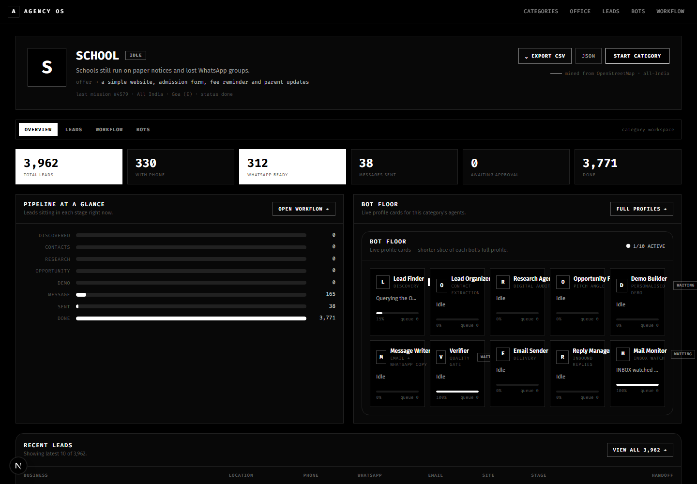
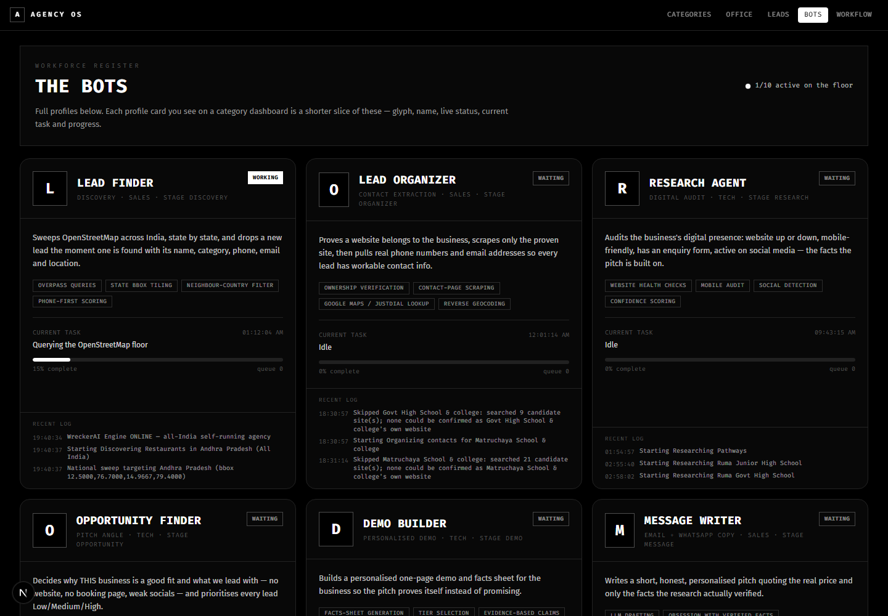
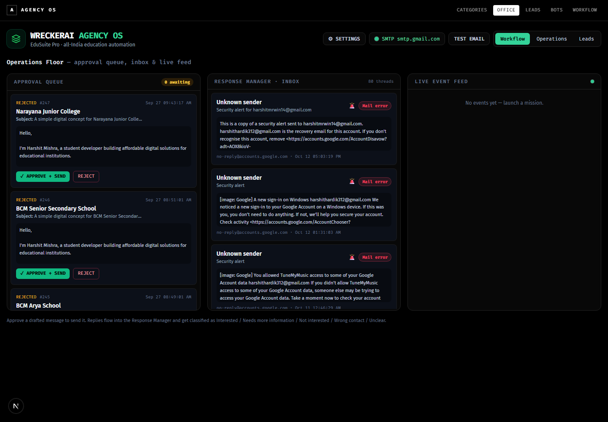
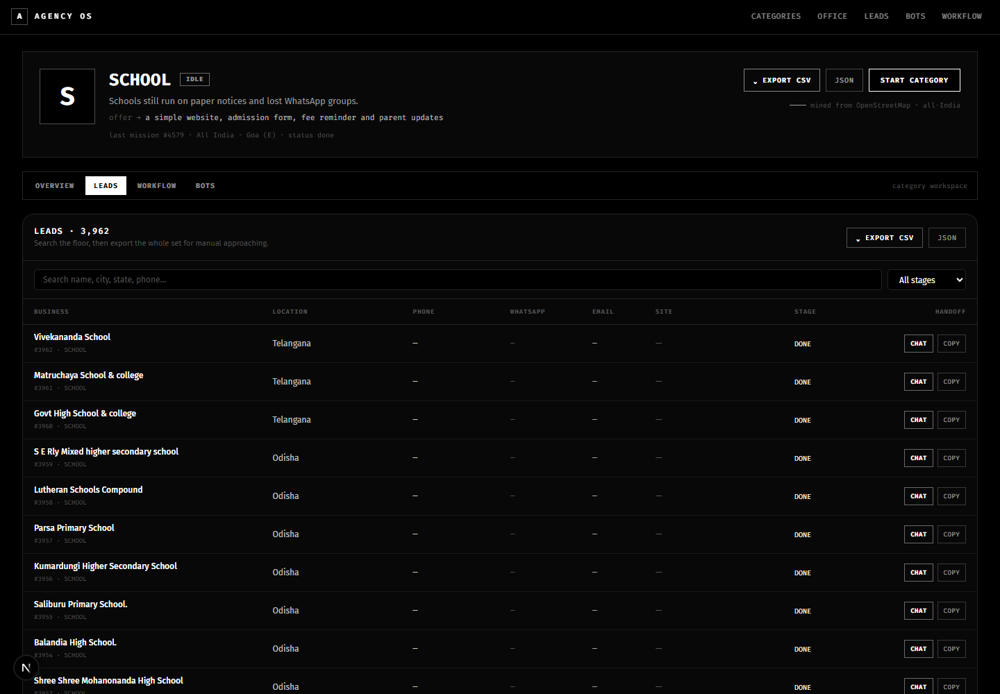
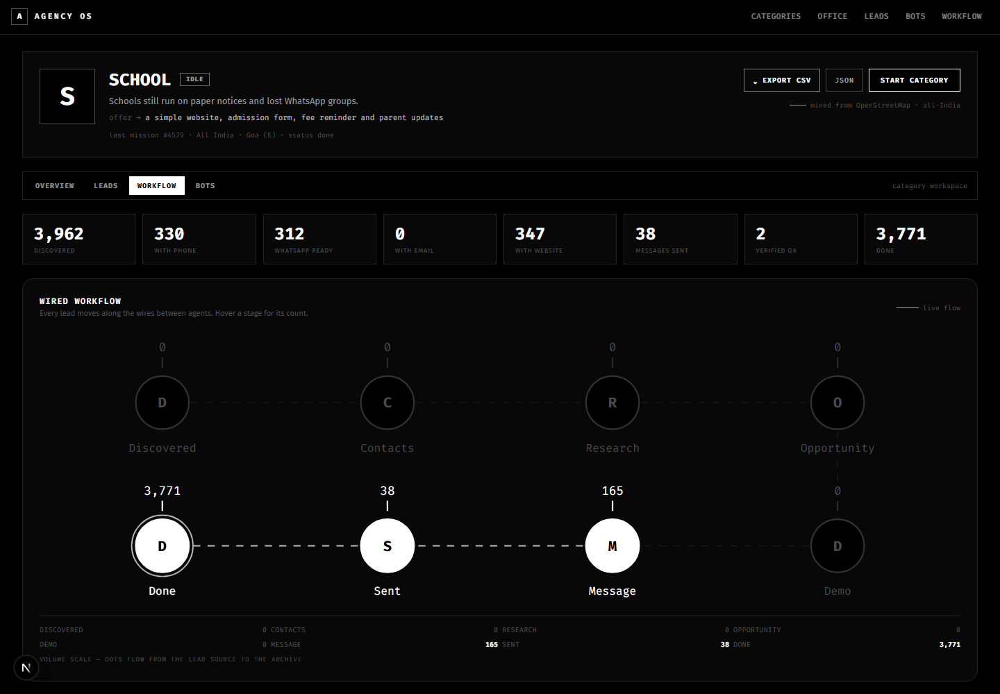

# Leads Workflow Automation — Agency OS

An autonomous **lead-extraction and outreach pipeline** for local businesses. It scrapes
business listings from OpenStreetMap (Overpass API), enriches each lead with contact info,
website, phone, and location, runs them through an agentic pipeline (`discover → organize →
write → verify → send → reply → book → done`), and hands every warm lead off to **WhatsApp**
via a `wa.me` deep link with the number already captured.

The UI follows a strict **no-slop design**: pure black background, white text, thin edges,
one monochrome accent. Nothing else.


## Why this exists

One-off spreadsheet lead-gen is stop-and-think work. Agency OS runs the boring loop for you:

1. **Discover** — pull every business of a chosen category from OpenStreetMap for a city.
2. **Organize** — split the free-form tags into clean fields: name, phones, WhatsApp number,
   website, email, address, city, category.
3. **Write** — an LLM drafts a category-specific outreach message per lead.
4. **Verify** — every draft is checked before anything is sent (domain ownership, SMTP
   mailbox probe, correct offer text). Passes are auto-approved.
5. **Send** — delivers via SMTP (Gmail app password) or flags the lead for WhatsApp handoff.
6. **Reply → Book → Done** — replies come back, appointments get booked, and the lead is
   marked finished.

Every stage is visible on the per-category dashboard and in the bot fleet status.

## Key features

- **Black / white, no-slop dashboard** — monochrome, high-contrast, fast.
- **5 lead categories** — `School`, `Restaurant`, `Cafe`, `Gym / Fitness`, `Salon / Beauty`.
- **Aesthetic category selector** on the home page — pick one category, start it anywhere.
- **Single active category** — the autonomous engine only ever runs the one category you
  chose at a time; switch categories and the engine switches with you.
- **Per-category workspace** — every category has its own subpages so nothing is crammed onto
  one screen:
  - `/c/[slug]` — **Overview**: key stat grid, pipeline-at-a-glance, bot floor, recent leads,
  - `/c/[slug]/leads` — full searchable **lead table** with stage filtering, copy/chat buttons,
  - `/c/[slug]/workflow` — the **wired workflow**, an animated SVG of all 8 pipeline stages,
  - `/c/[slug]/bots` — the full **bot profile cards** for that category.
- **Organized leads export** — clean CSV or JSON per category via
  `/api/categories/[slug]/export` with every field: name, all phones, WhatsApp number,
  website, email, address, city, coordinates, stage, timestamps.
- **Bot fleet** — 10 named bot profiles on every category dashboard plus a full `/bots` page
  with live status, current task, and a short log.
- **WhatsApp-first handoff** — `wa.me/<number>` deep links generated for every lead that has
  a WhatsApp-capable number (`whatsapp_available` flag captured during discovery/organizing).
  Email/SMTP pipeline stays enabled alongside.
- **Autonomous engine** — a background launcher keeps the active category's pipeline moving
  without a human in the loop (flip `AUTONOMOUS_MODE` to control it).

## Agent pipeline

| Agent | Stage | Job |
| --- | --- | --- |
| Discovery Agent | `discover` | Overpass query for the active category + city batch; capture address, phones, `whatsapp_available`, city. |
| Organizer Agent | `organize` | Split free-form OSM tags into clean structured lead fields. |
| Message Writer | `message` | LLM generates a category-specific outreach draft. |
| Verifier Agent | `verify` | Domain + SMTP mailbox checks; auto-approves or blocks. |
| Sender Agent | `send` | Delivers via SMTP; marks leads ready for WhatsApp handoff. |
| Reply agent | `reply` | Reads real inbound mail over IMAP and classifies it (interested / not interested / needs info). |

## Screenshots

| | |
| --- | --- |
| Category selector (home) |  |
| Category workspace — overview |  |
| Bot fleet profiles |  |
| Office / workspace |  |
| Category workspace — leads |  |
| Category workspace — workflow |  |

## Install & run

Requirements: **Node 22.5+** (uses Node's built-in `node:sqlite`; tested on Node 24), npm.

```bash
git clone https://github.com/WRECKERKNIGHT/leads-workflow-automation.git
cd leads-workflow-automation
npm install
# Windows:
copy .env.example .env.local
# macOS / Linux:
#   cp .env.example .env.local
#   then fill in at least OPENROUTER_API_KEY and SMTP_*
npm run scaffold-db          # creates the SQLite database file
npm run dev                  # http://localhost:3000
```

> Step-by-step setup on a fresh PC: [docs/SETUP.md](docs/SETUP.md).
> Real WhatsApp sending options (free wa.me links → Cloud API / Business app): [docs/WHATSAPP.md](docs/WHATSAPP.md).

Production build:

```bash
npm run build
npm start
```

### Env vars (`.env.local`)

| Variable | Default | Purpose |
| --- | --- | --- |
| `OPENROUTER_API_KEY` | — | Required. Model access for message/verifier agents. |
| `OPENROUTER_MODEL` | `minimax/minimax-m3:free` | LLM model id. |
| `GOOGLE_PLACES_API_KEY` | — | Optional. The only source that returns a business's own `website`. |
| `DISCOVERY_CATEGORIES` | all 5 | Comma-separated categories the pipeline may target. |
| `AUTONOMOUS_MODE` | `true` | Master switch for the background engine. |
| `AUTO_STATES` | empty (all-India) | Comma-separated states the launcher cycles through. |
| `AUTO_APPROVE` | `true` | Auto-approve verified drafts; set `false` for manual approval. |
| `MAIL_*` / `SMTP_*` | Gmail defaults | IMAP inbox monitoring + real email sending with a Gmail app password. |

## Using it

1. Open `/` — the aesthetic category selector. Pick a category and hit **Start**.
   The engine now runs *only* that category.
2. Open `/c/<slug>` (e.g. `/c/school`) — the category workspace. Use the tabs to move between
   **Overview**, **Leads**, **Workflow** and **Bots** subpages.
3. On the leads page, filter by stage, then use **Chat** (`wa.me`) or **Copy** to hand the
   lead off to WhatsApp. Use **Export CSV / JSON** for the full organized list.
4. `/bots` shows the whole bot fleet with live status and task logs.
5. `/office` and `/workflow` still hold the classic mission board and pipeline view.

## API surface

| Method | Route | Description |
| --- | --- | --- |
| `GET` | `/api/categories` | All categories with live stats. |
| `POST` | `/api/categories/active` | Set the single active category (`{ slug }`). |
| `GET` | `/api/categories/[slug]` | Category detail: stats, by-stage counts, bots, discoveries. |
| `GET` | `/api/categories/[slug]/export?format=csv\|json` | Organized leads export. |
| `GET` | `/api/bots` | Bot roster with live statuses and logs. |
| `POST` | `/api/leads/[id]/whatsapp` | Record a WhatsApp handoff for a lead. |

## Project layout

```
agents/       agent definitions (types, config, profiles, discovery, organizer, message)
app/          Next.js app router (pages + API routes)
components/   nav, category selector, workflow wires, lead table, bot cards/profiles
lib/          whatsapp helpers, runtime config, database (schema + repo)
scripts/      scaffold-db, run-mission
docs/         screenshots
```

## License

[MIT](LICENSE) — © 2026 WRECKERKNIGHT.